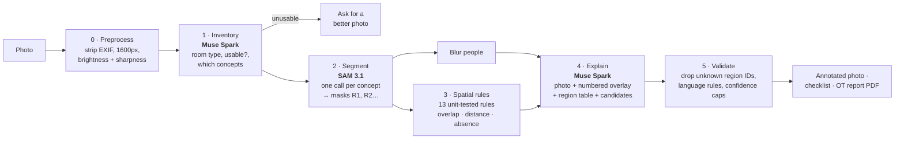

# AgeProof AI

**Photo-based home-safety screening for older people, built so the AI can't make up where a hazard is.**

Take a photo of a bathroom, bedroom, living room, kitchen, hallway or balcony. In about 20 seconds the photo lights up with numbered, colour-coded regions ("1 · Cord on the floor", "2 · No grab rail visible beside the toilet"), each with a plain-language explanation. One click turns it into a report to bring to an occupational therapist (OT).

> *AgeProof AI highlights possible hazards visible in photos. It cannot confirm whether a home is safe and does not replace an assessment by an occupational therapist or other qualified professional. Items not visible in the photos have not been checked.*

Built for the Meta Global AI Developer Hackathon (Indie track, *Build for Your World*) by a data analyst working in Australian aged care.

## Why

Falls are the leading cause of injury hospitalisation for Australians aged 65 and over (AIHW), and many happen at home: a loose bath mat, a cord across the floor, no rail beside the toilet. A home assessment by an OT is the right answer, but waits can be long and families often don't know what to point out. AgeProof AI is a **screening aid**: it helps people notice possible hazards and arrive at the OT visit with good questions. It never says a home is "safe".

## How it works

The key design idea: **the language model never places a hazard.** SAM 3.1 finds the regions, deterministic rules measure them, and Muse Spark only explains findings that cite real region IDs. A validator drops anything that doesn't.



| Step | What happens |
|---|---|
| **Preprocess** | EXIF and GPS removed (in the browser and again on the server), resized to 1600px, brightness and sharpness measured. |
| **Inventory** (Muse Spark) | Is this a usable photo of a room? What room is it, and which of 36 fixed concepts (rug, toilet, grab bar, cord, mould on wall…) appear? Clearly dark or blurry photos are turned away by measurement, whatever the model says. |
| **Segment** (SAM 3.1) | One text-prompted call per concept the inventory saw, plus floor, door and person, 6 in parallel. Masks become regions R1, R2… with boxes, areas and scores. |
| **Spatial rules** | 13 pure, unit-tested functions on a shared 4px grid: a rug on the floor within 8% of the diagonal of a shower, a cord ≥ 30% on the floor, no grab bar within 1.5 toilet widths, shoes on someone's feet ignored, and so on. Each emits a candidate with region IDs and a measurement. |
| **Explain** (Muse Spark) | Sees the photo, the same photo with numbered region outlines, the region table and the candidates. Confirms, rewords or rejects each candidate, and may add up to 3 observations, which must cite region IDs. |
| **Validate** | Drops findings that cite regions that don't exist (the hallucination metric), enforces the language rules, caps confidence for "not visible" findings, de-duplicates, and restores candidates the model skipped. If Muse Spark fails, the rule wording is shown instead. |

Full detail, including every rule and threshold: [docs/pipeline.md](docs/pipeline.md).

## What you get

- **Annotated photo**: each finding's region shaded orange, amber or grey by priority (never alarming red) with a numbered pin. Hover a pin ↔ highlight its row. "Show all detected objects" reveals every SAM 3.1 mask.
- **Plain-language findings**: why it may matter, what to discuss with an OT, and how it was found (the rule and its measurement, or a Muse Spark observation, with region IDs).
- **Pipeline timeline**: each step's model, time and detail, live while it runs.
- **OT report** (`/report/[id]`): priority summary, annotated photo, findings, one question per finding to ask the OT, the room's "check in person" list and space for notes. **Download as PDF** (built in the browser) or **Send as email** (the PDF goes to your mail app).
- **Bad photos**: too dark, too blurry or not a room → a clear explanation and tips instead of guesses.

## Evaluation

29 CC0 / public-domain room photos, labelled with the hazards a screener would flag ([eval/](eval/README.md)). `python eval/score.py` reproduces these from the committed results.

| | Precision | Recall |
|---|---|---|
| Bathroom (grab rails, bath edges) | 92% | 100% |
| Trips (rugs, mats, cords, things on the floor) | 90% | 67% |
| Lighting | 80% | 100% |
| **All findings** | **78%** | **77%** |

- **Photo check:** 24 of 24 photos screened or turned away as expected (5 more were borderline, so either answer counts).
- **Grounding:** 5 of 45 Muse Spark findings (11%) were dropped by the validator for citing regions that don't exist. They never reach the user.
- **Speed and cost:** 18.4s and $0.034 per photo on average (25 live runs).
- **Tuning:** the first run scored 46% precision because Muse Spark added generic remarks ("low drawers may need bending") to almost every photo. Tightening the explain prompt raised precision to 78% with recall unchanged.
- **Weakest area:** reach (high shelves and cupboards): 0 of 2 found.

Labels were drafted by the coding assistant from visual inspection, not by an OT, so treat these as a sanity check rather than a validation study. Many findings counted as "wrong" are real things the conservative labels leave out (a narrow doorway, a low chair); see `python eval/score.py --detail`.

## Responsible AI

- Never says "safe", "unsafe", "compliant" or gives a score; enforced in code, with a fallback to fixed wording.
- Suggestions are things to *discuss with an OT*, never instructions ("install…").
- Absence is "not visible in this photo", confidence capped at medium.
- People are blurred before the photo is shown or sent to Muse Spark again.
- Nothing is stored on the server; results live in the browser tab. Only Standard-mode Meta models (contributor variants are refused in code).

Every safeguard and where it lives: [docs/responsible-ai.md](docs/responsible-ai.md).

## Demo mode

Open the app with `?demo=1` and the three sample rooms replay saved results with their real step timings: no API calls. Without `?demo=1`, the sample rooms run live, and if the API fails they fall back to the saved result automatically. Regenerate the saved results with `npm run demo:build`.

## Run locally

Needs Node ≥ 22 (and Python 3 for the eval).

```bash
npm install
cp .env.example apps/web/.env.local   # then add MODEL_API_KEY
npm run dev                           # http://localhost:3000  (add ?demo=1 for demo mode)
npm test                              # vitest: rules, validation, report, schemas
npm run smoke:meta                    # one Muse Spark + one SAM 3.1 call on demo/bathroom-1.jpg
npm run pipeline -w apps/web          # pipeline on demo/* → apps/web/.cache/out/ (JSON + overlay PNGs)
npm run demo:build                    # regenerate apps/web/public/demo/*.json
npm run eval                          # pipeline on eval set, then python eval/score.py
```

## Repo layout

```
apps/web
  app/              / (upload), /result/[id], /report/[id], /api/analyze (NDJSON stream)
  lib/pipeline/     preprocess, inventory, segment, rules, explain, validate, report, analyze
  lib/meta/         Muse Spark + SAM 3.1 clients (timeout, retry, cache, cost log)
  lib/prompts/      versioned prompts
  lib/schema/       zod schemas: the single source of truth for every JSON shape
  public/demo/      saved results for demo mode
demo/               sample photos (see demo/SOURCES.md)
eval/               labels.json, score.py, results/
docs/               pipeline.md, responsible-ai.md, meta-api-notes.md
```

## Licence

MIT. Committed photos are CC0 or public domain (see [demo/SOURCES.md](demo/SOURCES.md)).
